# 🧠 Knowledge Graph

**A local learning environment for computer science & mathematics.** Your knowledge is a graph of concepts linked by
prerequisites. An AI tutor (GitHub Copilot) teaches short lessons, quizzes you with confidence + reasoning, sets your real
mastery level, and sends you to hands-on challenges, projects, open-source issues and job targets — using your own PDF books
only as a *fact-checking reference*, so you never have to read them cover to cover.

Current focus: **AI · Security · Systems programming** (+ the math underneath). The vault ships with ~80 concepts, 4 roadmaps
and a starter set of projects; the graph grows with whatever *you* decide to learn.


## Contents

- [What's inside](#whats-inside) · [Quick start](#quick-start) · [Using it like an app](#open-it-like-a-normal-app-windows)
- [A tour of the app](#a-tour-of-the-app)
  [Today](#-today) · [Graph & Tutor](#-graph--tutor) · [Add any topic](#-add-any-topic--the-graph-grows-on-demand) ·
  [Learn](#-learn-mode) · [Quiz](#-quiz-mode) · [Build](#-build--projects--open-source) ·
  [Challenges](#-challenges--codeforces-for-development) · [Jobs](#-jobs--roles-skill-gaps-live-search)
- [How the knowledge model works](#how-the-knowledge-model-works) · [Books (PDFs)](#books-pdfs) · [Configuration](#configuration)
- [Command line](#command-line) · [Project layout](#project-layout) · [Security & privacy](#security--privacy)
- [Designed from learning science](#designed-from-learning-science) · [Troubleshooting](#troubleshooting) ·
  [Development](#development) · [Ideas for later](#ideas-for-later)

## What's inside

| | Section | What it does |
|---|---|---|
| 🏠 | **Today** | One next-best action: a 5/10/20-minute session (reviews due → learn something new), a **Start here** checklist, progress by domain |
| 🧠 | **Graph & Tutor** | Interactive prerequisite graph, lesson maps, 📘 Learn and 🎓 Quiz with an AI tutor, **➕ add any topic** |
| 🛠 | **Build** | Sync your GitHub projects/PRs, find open-source issues that fit you, get project ideas that practise concepts |
| 🏁 | **Challenges** | Codeforces-style problems for *development* (CLIs, parsers, REST APIs, security/systems tasks) with hidden tests and Elo ratings, in 13 languages |
| 💼 | **Jobs** | Target roles, the skills they need vs. what your graph covers, live job search; missing skills become graph concepts |
| ⌨ | **CLI** (`kg`) | check / build / ingest / search / progress / next / review / rate / new / judge / serve |

Everything is plain files: **Markdown notes with YAML frontmatter** in `vault/` (open it in Obsidian if you like), a SQLite
full-text index for your books, and a small local web app. No database server, no cloud service besides Copilot.

## Quick start

**Requirements:** Windows 10/11 (the scripts are PowerShell; the app itself is cross-platform Python), Python 3.12+,
Git, a **GitHub Copilot** subscription (the tutor uses the Copilot SDK — no API keys), and Chrome or Edge.
Optional: the [GitHub CLI](https://cli.github.com) signed in (`gh auth login`), compilers for the languages you want to practise.

```powershell
git clone https://github.com/BLANK00ANONYMOUS/cs-knowledge-graph.git
cd cs-knowledge-graph
.\setup.ps1                 # creates .venv, installs dependencies, validates and builds the graph
.\kg.cmd serve --open       # http://127.0.0.1:8765  — Today · Graph & Tutor · Build · Challenges · Jobs
```

Then follow the **Start here** checklist on the Today page. In ten minutes you will have picked a focus, taken a placement
quiz, finished a lesson and added your first topic.

> **Sign-in:** the server finds a GitHub token from `GH_TOKEN`/`GITHUB_TOKEN`, then from `gh auth token`. If the tutor shows
> *"No GitHub OAuth token"*, run `gh auth login` (or set `GH_TOKEN`) and restart.

### Open it like a normal app (Windows)

```powershell
.\tools\install.ps1              # Start Menu + Desktop shortcut "Knowledge Graph"
.\tools\install.ps1 -AutoStart   # also start the server (hidden) when you sign in
.\tools\install.ps1 -Uninstall   # remove the shortcuts
```

Press the Windows key and type **Knowledge Graph**: the launcher (`tools/launcher.py`) starts the server in the background if
needed and opens the app in its own window (Chrome/Edge app mode, no tabs or address bar). *Knowledge Graph (stop server)*
shuts it down; logs go to `.kg/server.log`.

## A tour of the app

`kg serve` runs **one app** on `http://127.0.0.1:8765`: a shell at `/` with five sections — **Today** (`/today`),
**Graph & Tutor** (`/graph`), **Build** (`/build`), **Challenges** (`/arena`) and **Jobs** (`/jobs`). Each section stays loaded
in its own frame, so **a quiz, lesson or generation keeps running while you switch sections** — the tab shows a spinner while
it is busy and a green dot when it finished. `Alt`+`1`…`5` switches sections and **❓ How it works** explains the loop:

> **📘 Learn** a concept → **🎓 Quiz** to set your level → **🛠 Apply** it → **🔁 Review** when it is due.

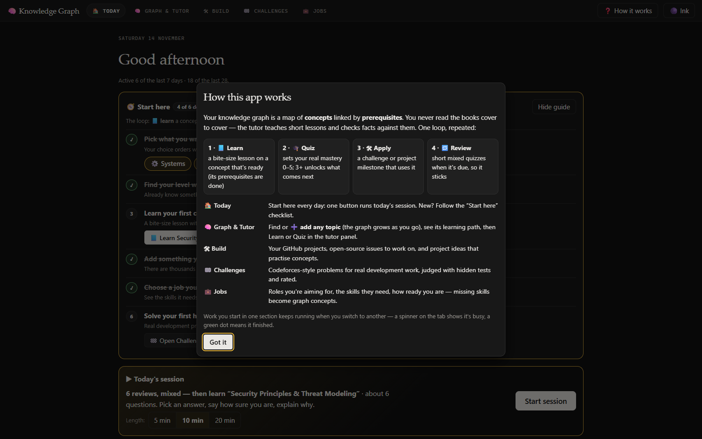

### 🏠 Today

Open the app and there is exactly one thing to do: **Start session**. It builds a time-boxed session from what is due —
a mixed review of concepts you learned earlier, then one new concept whose prerequisites you have mastered. Your **focus areas**
(Systems, Security, AI, CS, Math) decide which "ready to learn" concepts come first.

New users get a **🧭 Start here** checklist — pick your focus, take a placement quiz, learn a concept, add a topic, choose a job
target, solve a challenge — which ticks itself off as you go and can be hidden. Further down: reviews due, concepts ready to
learn, projects in progress, challenge ratings, mastery per domain and a gentle 4-week activity grid (rest days are fine, no streak shaming).
Progress and focus live in `.kg/profile.json` on your machine.

### 🧠 Graph & Tutor

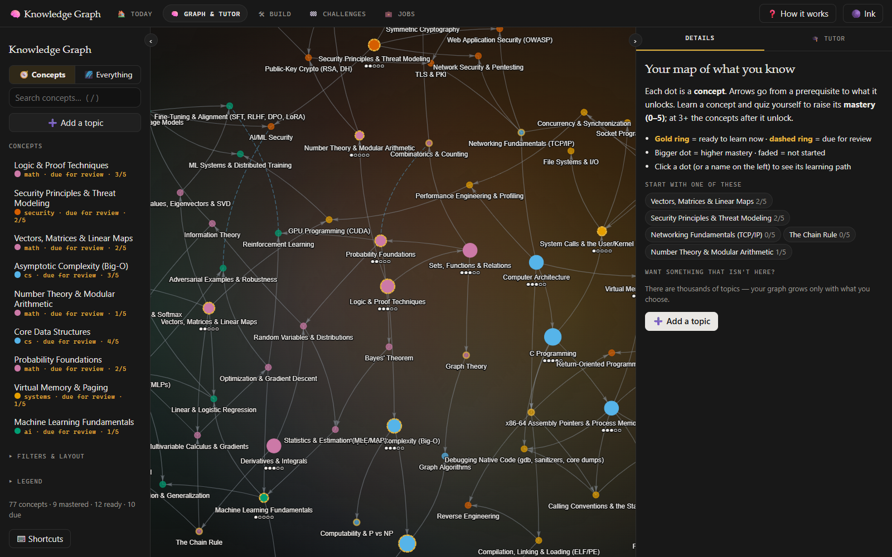

- **Dots are concepts.** Bigger = higher mastery, faded = not started, a **gold ring** = ready to learn now, a **dashed ring** =
  due for review. Colours (colour-blind-safe Okabe–Ito palette) are domains; shapes mark other note types.
- **Concepts / Everything** switch (top left): *Concepts* shows only the learning graph; *Everything* adds projects ◆,
  contributions ▲, books ■, challenges ⬢ and roles ▽ with their links.
- **The concept list** (left) is ordered by what to do next: due → ready → in progress → locked → mastered. Type to filter;
  if nothing matches, a button offers to **add it to your graph**.
- **Select a concept** and everything unrelated dims; its prerequisite path is highlighted and the Details panel shows a
  **lesson map** (green = mastered, amber = in progress, red = to learn), what it unlocks, related concepts, and the projects
  that practise it.

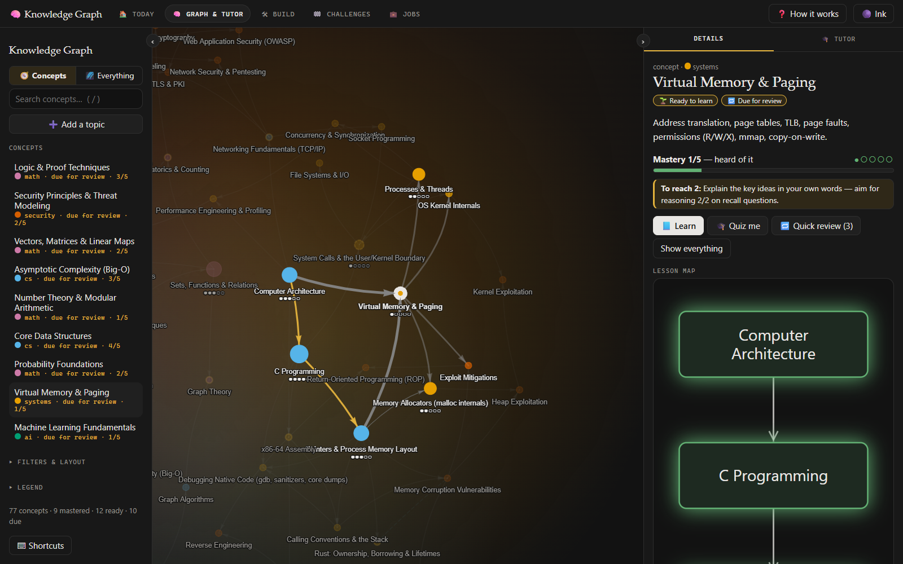

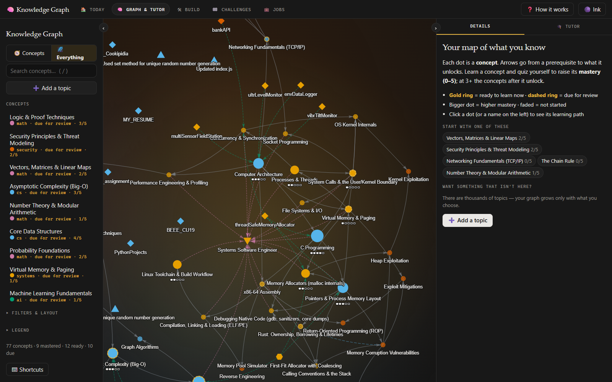

The side panels are **resizable** (drag the edge; double-click or `Home` resets), **collapsible** (‹ › buttons or `[` / `]`) and
remember their size. **Focus mode** hides the graph during a quiz. `/` searches, `Esc` clears focus, `?` shows all shortcuts.

### ➕ Add any topic — the graph grows on demand

There are thousands of topics; you decide which belong in your head. Type anything — *Docker containers*, *RSA*, *transformers*,
*Bayes' theorem* — in the graph search, the **➕ Add a topic** button, or the box on Today:

1. Copilot first checks whether an existing concept **already is** that topic and offers to learn it.
2. Otherwise it designs the new concept **plus only the prerequisite concepts that are missing**, linked to concepts you already have
   (prerequisites first, your topic last, no cycles).
3. You review the plan and **uncheck anything** you don't want; nothing is written until you press *Add to my graph*.
   The notes land in `vault/<domain>/<slug>.md` with tag `added`.

**💡 Ideas for me** suggests valuable concepts that are not in the graph yet, based on your mastery, focus and goals.

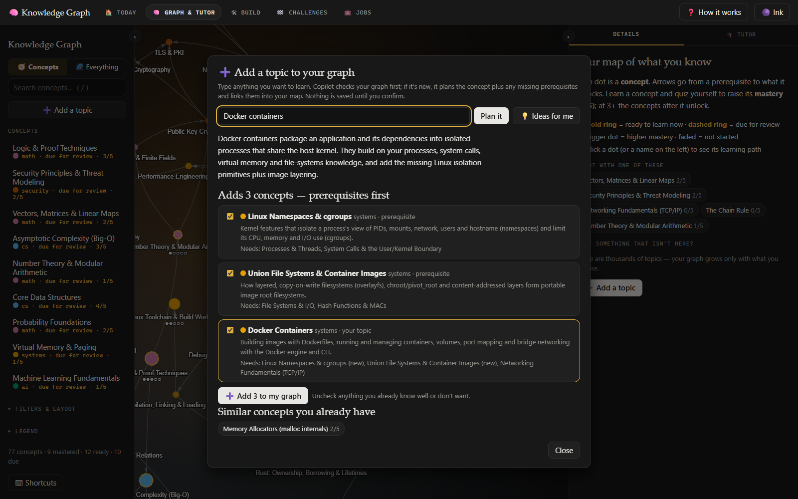

### 📘 Learn mode

Pick a concept → **📘 Learn**. Copilot writes a bite-size lesson **in its own words**, fact-checked against your PDF library
(it searches the books first and shows the pages it used as *verified* badges — the books are its reference, not your homework):

1. 3–5 short parts, each with a worked example (C/C++ for systems and security, Python for AI and maths) and an instant
   quick-check question — retrieval right after each chunk.
2. Key takeaways, then **🛠 Apply it**: a 20–60 minute hands-on exercise with success criteria. Paste your code or output and
   press **🔍 Review my work** for feedback.
3. **✅ Mark as learned** (mastery ≥ 1) or **🎓 Quiz me** to earn your real mastery level.

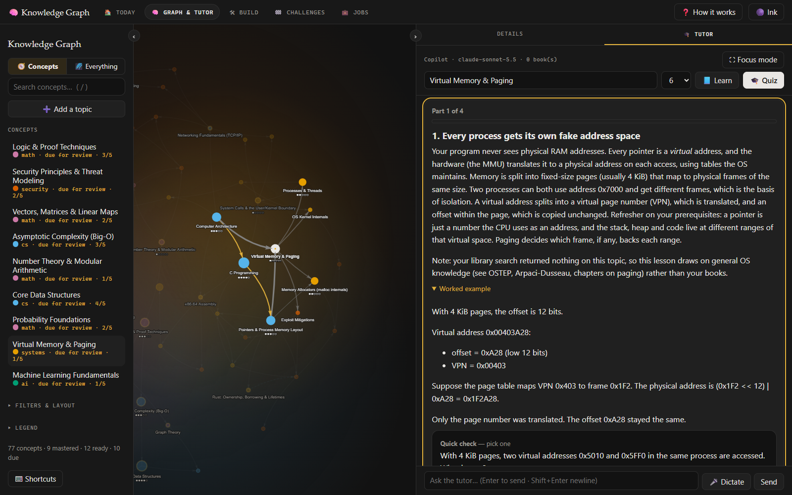

### 🎓 Quiz mode

A conversation panel next to the graph, powered by **GitHub Copilot via the Copilot SDK**. Click a concept → **Quiz**, or type a topic:

1. **Adaptive questions**, one at a time, as *prediction cards*: pick an option (or **I don't know**), set your **confidence
   slider *before* the answer is revealed**, then explain your reasoning in **Your thinking** (`Enter` submits; 🎤 dictation works).
   Correct answers never reach the browser until you have answered.
2. The tutor grades your **reasoning** (0–2), names misconceptions, explains why each wrong option is wrong, and adapts the next
   question: harder after strong answers, prerequisite probes after weak ones.
3. A **report** with level, strengths, gaps, a calibration table (confident-and-wrong answers are flagged first — the most
   valuable errors), suggested mastery per concept and an ordered **study plan**. Apply the ratings to the graph with one click.

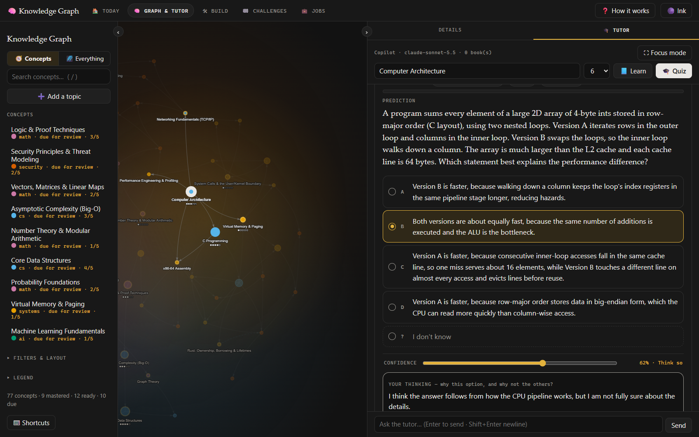

Plans are saved to `plans/YYYY-MM-DD-<topic>.md` and logged in `journal/`. **🎤 Voice dictation** (mic button or `Ctrl`+`Space`)
uses the browser's Web Speech API (Chrome/Edge; set the language with `tutor.speech_lang`, e.g. `en-IN`, `hi-IN`).

### 🛠 Build — projects & open source

Real learning happens by building.

- **📊 My work** — **Sync from GitHub** pulls the public repos, PRs and issues of the account in `github.username` into the vault:
  repos → `vault/projects/gh-*.md`, PRs/issues → `vault/contributions/*.md`. Copilot tags each with the concepts it exercises,
  creating `practices` edges, so concepts show *"Practised in projects"* in the graph. Re-syncing only updates state (merged,
  closed, stars, last push) and never overwrites your *What I learned* notes.
- **🔎 Find issues** — finds healthy repositories (by language, stars, recent activity, good-first-issue counts) and their open,
  unassigned issues; Copilot ranks them for *you* (fit ★, difficulty, what you'll learn, first steps). **Track** saves one as a
  contribution target with a milestone checklist.
- **💡 Project ideas** — Copilot designs projects around concepts you are ready for or weak in (and recent quiz gaps) with
  testable milestones and an open-source angle. **Add** creates `vault/projects/proj-*.md`; tick milestones and move the status
  idea → active → done.

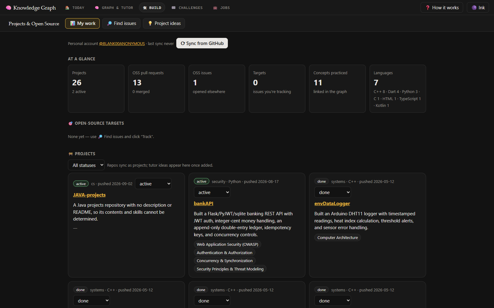

> A work account that is an Enterprise Managed User cannot contribute to public repositories, so contributions are tracked for
> your **personal** account through read-only public API calls (authenticated with your `gh` login for rate limits).

### 🏁 Challenges — Codeforces for development

Practical development problems instead of algorithm puzzles: CLI tools, parsers for real formats, stateful stores, REST APIs,
security and systems tasks — in the language you want to practise.

1. **Generate** — pick a track (backend / systems / security / ai / tooling), language, difficulty (800–2400, suggested from your
   rating) and optionally a concept to practise. Copilot writes the statement, interface, idiomatic starter code, public examples,
   hidden tests and a **hidden Python reference solution**. The challenge is published only after the reference passes every test
   (disagreements get one AI repair round; tests that still disagree are dropped), so the judge can be trusted.
2. **Solve** in your editor: `challenges/<slug>/solution.<ext>` (`Main.java` for Java; `README.md` has the full statement).
3. **Judge** — **▶ Run** the public tests or **🚀 Submit** for public + hidden tests, from the page or the terminal:
   `.\kg.cmd judge <slug>` / `.\kg.cmd judge <slug> --submit`. Verdicts: Accepted / Wrong Answer / Time Limit Exceeded /
   Runtime Error / Compilation Error, with a diff for failing public tests.
4. **Learn** — 💡 progressive hints, 🔍 AI code review (correctness, design, error handling, readability, security) and the
   editorial + reference unlock after you solve it or give up.

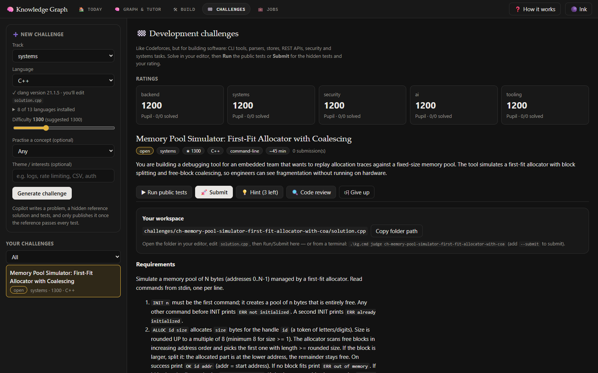

**Languages.** Tests only talk to your program through stdin/stdout, arguments, files and exit codes (or HTTP), so the judge is not
tied to one language:

| Language | File | How the judge builds/runs it | Install if missing |
|---|---|---|---|
| Python | `solution.py` | the app's Python 3 | always available |
| C / C++ | `solution.c` / `.cpp` | first working clang/gcc, `-O2 -static` (C17 / C++20) | MSYS2 + `mingw-w64-ucrt-x86_64-clang` |
| Rust | `solution.rs` | `rustc -O --edition 2021` | `winget install Rustlang.Rustup` |
| Go | `solution.go` | `go build` | `winget install GoLang.Go` |
| Java | `Main.java` | `javac`, then `java -cp … Main` | `winget install Microsoft.OpenJDK.21` |
| Kotlin | `solution.kt` | `kotlinc -include-runtime`, then `java -jar` | Kotlin compiler (`scoop install kotlin`) + a JDK |
| C# | `solution.cs` | the SDK's `csc` (implicit usings like `dotnet run app.cs`), `dotnet solution.dll` | `winget install Microsoft.DotNet.SDK.10` |
| JavaScript | `solution.js` | `node` (built-in modules only) | `winget install OpenJS.NodeJS.LTS` |
| TypeScript | `solution.ts` | `node --experimental-transform-types` (Node ≥ 22.6; types are stripped, not checked) | same as Node |
| Ruby | `solution.rb` | `ruby` | `winget install RubyInstallerTeam.Ruby.3.4` |
| PHP | `solution.php` | `php` | `winget install PHP.PHP.8.4` |
| Dart | `solution.dart` | `dart compile exe` | `winget install Google.DartSDK` |

The page checks each toolchain by compiling and running a tiny program (cached in `.kg/toolchains.json` until the toolchain
changes). Missing languages stay in the list as *"(not installed)"* with their install command; after installing one, reload the
page — no restart needed. HTTP-service challenges are offered for languages with an HTTP server in their standard library
(Python, JavaScript, TypeScript, Go, Java, Kotlin, Dart); the others get command-line challenges.

**Ratings** are Elo-style per track (start 1200; Newbie → Pupil → Specialist → Expert → …). Only the first resolution of each
challenge counts: Accepted scores 1 minus 0.1 per wrong submission and 0.05 per hint (minimum 0.5); giving up scores 0. Solved
challenges appear in the graph (⬢) with `practices` links to their concepts.

Files: `challenges/<slug>/` (your code, committed) · `challenges/history.json` (rating history) · `vault/challenges/<slug>.md`
(graph node) · `.kg/challenges/<slug>/` (hidden tests, reference, builds — gitignored). Judged programs run with a minimal
environment (no tokens), in a temp directory, with a 5 s limit per test plus a startup allowance for runtimes (JVM +2 s, .NET +1.5 s,
Node +1 s, Ruby/PHP/Dart +0.5 s); the AI-written reference is screened for unsafe APIs (subprocess, deletes, eval…) before it runs.

### 💼 Jobs — roles, skill gaps, live search

Aim at something concrete and let the graph close the gap.

- **Add a role** by **title**, by **pasting a job description**, or click **✨ Suggest roles for me** (12 suggestions with Indian
  job-market titles — SDE, Embedded, Firmware, AppSec, SRE, ML… — ranked by fit with your graph and goals).
- Copilot lists the **skills the role needs** (must / should / nice) and maps each to a concept in your graph. You get a weighted
  **readiness %**, a next step, and **Learn / Quiz / Graph** buttons on every skill.
- Skills that aren't in the graph yet can be **added as new concepts in one click** (with prerequisites linked to existing concepts).
- **Search live jobs** uses the free Remotive and Arbeitnow boards (no API key). **Analyse** turns a posting into a role.
  Posting text is treated as untrusted data (it cannot instruct the model), and only `https` links are shown.
- Roles are vault notes (`vault/roles/`, type `role`, `requires:` links, ▽ in the graph) with interview topics and portfolio
  project ideas. Track your status: target → applied → interviewing → offer.

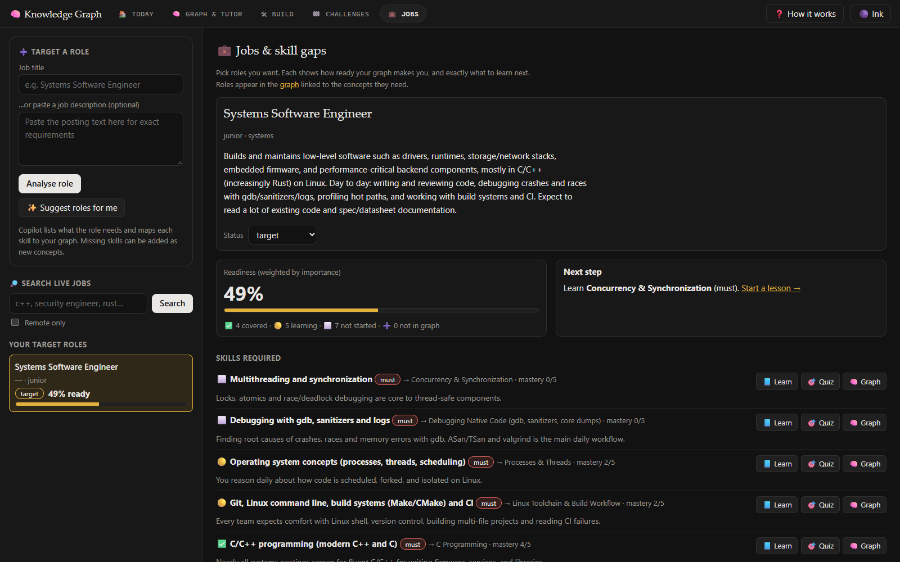

**Themes:** the button in the corner cycles Auto (follows your OS), Ink, Paper, Mocha, Rosé Pine and Gruvbox (tokens live in
`tools/common.css`).

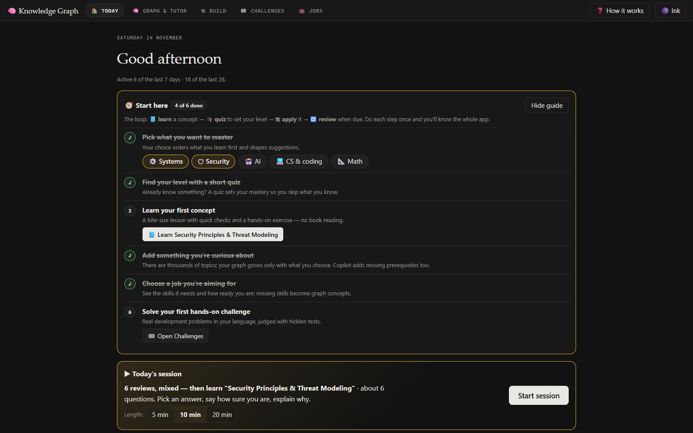

## How the knowledge model works

```
 your PDFs (books_dir) ──kg ingest──▶ .kg/index.db  (full-text, per page)
                                          │                     ▲
                                          ▼                     │ kg search / tutor fact-checking
 vault/books/book-*.md ──covers──▶ vault/<domain>/<concept>.md ◀──prereqs── …
                                          │
              kg build ──▶ build/graph.html (interactive)   ·   kg next / review / rate   ·   kg serve (the app)
```

- **Vault** (`vault/`): one Markdown note per item with YAML frontmatter. Filenames are slugs; `[[slug]]` links also work in Obsidian.

  | Type | Folder | Purpose | Edge fields |
  |---|---|---|---|
  | `concept` | `vault/<domain>/` (`math`, `cs`, `systems`, `security`, `ai`, `meta`) | one lesson-sized idea | `prereqs`, `related` |
  | `roadmap` | `vault/roadmaps/` | staged paths for Math, Systems, Security, AI | — |
  | `book` | `vault/books/` | an indexed PDF with its chapter outline | `covers` |
  | `project` | `vault/projects/` | a repo you built or an idea to build | `practices` |
  | `contribution` | `vault/contributions/` | an open-source PR/issue (done or tracked target) | `practices` |
  | `challenge` | `vault/challenges/` | a judged development challenge | `practices` |
  | `role` | `vault/roles/` | a job you target, its skills and status | `requires` |

- **Mastery (0–5)** — 0 not started · 1 heard of it · 2 can explain the basics · 3 can apply it · 4 can implement/teach it · 5 expert.
  A concept is **ready** when all its prerequisites are ≥ 3. **Spaced review** intervals by mastery: 1 d, 3 d, 7 d, 21 d, 60 d.
- **Prerequisite edges win** over related/mention edges between the same two notes; cycles are rejected by `kg check`.
- **Copilot (editor)**: `.github/copilot-instructions.md` defines tutor behaviour in a Copilot session in this repo (try *"Teach me
  backpropagation"*, *"Quiz me on what's due"*, *"Ingest my new books"*); `.github/skills/` has the `teach` and `study-book` workflows.
- **Validation**: `setup.ps1` installs a pre-commit hook (`.githooks/pre-commit`) that runs `kg check`.

## Books (PDFs)

Drop PDFs into the folder set as `books_dir` in `kg.config.yaml` (default `books/`) and run `.\kg.cmd ingest`. Each PDF gets a book
note with its chapter outline, every page becomes searchable (BM25), and `covers` links connect books to concepts. **PDFs and
extracted text never enter Git** (`/books/` and `vault/books/*` are git-ignored). Lessons, quizzes and study plans cite book pages
that were actually returned by search and badge them *verified* / *unverified* / *external*.

- Scanned PDFs have no text layer; `kg ingest` warns about them. OCR first (e.g. `ocrmypdf in.pdf out.pdf`).
- OneDrive "online-only" files download on first read; large libraries take a while on the first ingest. Re-runs skip unchanged
  files (SHA-1).
- No books yet? Everything still works — the tutor teaches from general knowledge and says so (as in the lesson screenshot above).

## Configuration

`kg.config.yaml`:

```yaml
vault_dir: vault
books_dir: "books"          # folder with your own PDFs (never committed); KG_BOOKS_DIR overrides it

tutor:                      # kg serve
  model: claude-sonnet-5.5  # any Copilot model id; if it is unavailable the server falls back automatically
  questions: 6              # questions per quiz
  port: 8765
  speech_lang: en-IN        # dictation language (BCP-47)

github:                     # Build + Jobs
  username: BLANK00ANONYMOUS  # the personal account to track (change this to yours)
  languages: [Python, C, C++, Rust, Go]
  min_stars: 50             # for "Find issues"
```

Local state (all git-ignored under `.kg/`): the full-text index, the Copilot SDK runtime, hidden challenge tests, `profile.json`
(focus areas + onboarding progress), `toolchains.json`, `server.log`.

## Command line

| Command | What it does |
|---|---|
| `kg serve [--open] [--model ID] [--port N]` | The web app: Today, Graph & Tutor, Build, Challenges, Jobs |
| `kg judge <slug> [--submit]` | Judge a development challenge (public tests, or all tests + rating) |
| `kg next [--domain ai] [-n 10]` | Concepts ready to learn |
| `kg review` | Concepts due for spaced review |
| `kg rate <slug> <0-5>` | Record mastery and stamp `last_reviewed` |
| `kg search "<query>" [--kind note\|book] [--ref slug] [--json]` | Full-text search over notes and book pages |
| `kg ingest [--force] [--books-dir DIR]` | Index new/changed PDFs and create book notes |
| `kg new <domain> "<Title>" --prereqs a,b --summary "…"` | Scaffold a concept note |
| `kg check [--warnings]` | Validate: missing links, prerequisite cycles, bad fields |
| `kg build [--open]` | Generate `build/graph.html` + `build/graph.json` (a static, read-only viewer) |
| `kg progress` | Mastery per domain |

Run them as `.\kg.cmd <command>` from the repository root.

## Project layout

```
vault/                 the knowledge graph (Markdown + YAML frontmatter)
challenges/            your challenge solutions and rating history
plans/  journal/       study plans written by the tutor · short session log
tools/
  kg.py                CLI + vault model (notes, edges, mastery, spaced review, search, graph data)
  server.py            aiohttp app: pages + JSON API, bound to 127.0.0.1
  tutor.py             Copilot SDK engine: quizzes, lessons, reports, chat, model verification/fallback
  topics.py            "add any topic": existing-concept check, prerequisite planning, topic ideas
  builder.py           Build page: GitHub sync, issue finder, project ideas (+ shared vault helpers)
  arena.py             Challenges: generation, validation, 13-language judge, ratings
  jobs.py              Jobs: role analysis, readiness, live job boards
  launcher.py install.ps1   desktop launcher and shortcut installer
  shell_template.html  the app shell; today / graph / build / arena / jobs _template.html run inside it
  common.css common.js shared design system, themes, KG.* helpers (API, routing between sections, toasts)
.github/               Copilot instructions + skills
.githooks/pre-commit   runs `kg check`
docs/screenshots/      images used in this README
```

The server exposes a small JSON API used by the pages (`/api/graph`, `/api/today`, `/api/assessments`, `/api/lessons`,
`/api/topics/*`, `/api/build/*`, `/api/arena/*`, `/api/jobs/*`, `/api/profile`, `/api/health`). Pages are templates re-read on
every request, so HTML/CSS/JS edits show up on refresh; Python changes need a server restart.

## Security & privacy

- The server binds to **127.0.0.1 only**, and every state-changing request must carry the `X-KG` header (rejects cross-site requests).
- Your books, notes and progress stay on your machine. The only external calls are to GitHub Copilot (prompts include concept
  notes and book snippets), the public GitHub API (Build), the Remotive/Arbeitnow job APIs (Jobs) and the browser's speech service
  if you use dictation.
- Job postings, repository text and issue bodies are untrusted: they are wrapped as data in prompts, rendered through
  escaping/DOMPurify, and links are limited to `https`.
- Challenge code runs locally with a minimal environment (no tokens), a temp working directory and time limits. It is **not a
  security sandbox** — only run solutions you wrote.
- The AI-generated reference solutions are screened for unsafe APIs before they run.

## Designed from learning science

The UI follows evidence-based learning research (Dunlosky et al. 2013, Roediger & Karpicke 2006, Cepeda et al. 2006,
Butterfield & Metcalfe 2001, Hattie & Timperley 2007, Chi et al. 1994, Rohrer & Taylor 2007, Sweller's cognitive-load work,
Shneiderman's visualisation mantra, NN/g, WCAG 2.2):

| Principle | Where you see it |
|---|---|
| Retrieval practice + spacing | **Today** shows one next-best action: a time-boxed session built from reviews due + one new concept |
| Interleaving | Review sessions rotate through several concepts instead of blocking one topic |
| Metacognitive calibration | Every question asks *Guessing / Think so / Sure* **before** the answer is revealed; confident errors are flagged as top priority (hypercorrection) |
| Elaborated, task-focused feedback | Verdict → misconception → why your option is wrong → why the right one is right → reasoning score → your reasoning vs. the worked explanation |
| Self-explanation | A required "why this option — and why not the others?" box (type or 🎤 dictate) |
| Mastery learning | Concepts show 🔒 locked (which prerequisites are missing) / 🌱 ready / ✅ mastered, plus "to reach the next level" criteria |
| Overview → zoom → details on demand | Selecting a concept dims everything except its prerequisite chain; **Highlight** filter for ready / due / gaps / mastered / practised |
| Cognitive load | One question per card, details behind expanders, **Focus mode** hides the graph during a quiz |
| Motivation without dark patterns | A gentle 4-week activity grid (no streak shaming), domain progress, a calm "🎉 Mastered" toast |
| Responsiveness | Named loading stages with elapsed time and **Cancel** for long waits; work keeps running when you switch sections |
| Accessibility | WCAG-contrast themes, visible focus rings, ≥ 32 px targets, `aria-live` feedback, colour-blind-safe palette + shapes/pips/dashed rings, `prefers-reduced-motion`, keyboard shortcuts (`1`–`4`, `/`, `Esc`, `?`, `Alt`+`1`…`5`) that can be switched off |

Design: a calm "ink" look — near-black neutrals, a warm gold accent, serif headings, small monospace uppercase labels.

## Troubleshooting

| Problem | Fix |
|---|---|
| `JSON-RPC … No GitHub OAuth token` | Run `gh auth login` (or set `GH_TOKEN`) and restart the server. A stale `gh` login is the usual cause. |
| `Model "…" is not available` | The server verifies the configured model at startup and before each request and falls back to another one automatically. If it says no model is available, check your Copilot plan/sign-in. |
| The page looks stale | Hard-refresh (`Ctrl`+`F5`). Python changes need a server restart; use *Knowledge Graph (stop server)* or `Ctrl`+`C`. |
| Port 8765 is in use | A previous server is still running — stop it, or `kg serve --port 8770`. |
| A language shows "(not installed)" | Install it (command shown in the page / table above) and reload the page. |
| C/C++ challenges fail to compile | The judge uses the first working clang/gcc. On Windows install MSYS2's `mingw-w64-ucrt-x86_64-clang`. |
| Dictation does nothing | Use Chrome or Edge and allow microphone access; set `tutor.speech_lang`. |
| `kg check` fails on commit | Fix the reported note, or commit with `--no-verify` as a last resort. |

## Development

```powershell
.\kg.cmd check            # validate the vault (also the pre-commit hook)
.\kg.cmd serve --port 8770   # run a second instance while developing
```

- Templates are plain HTML/CSS/JS with no build step (vis-network, marked and DOMPurify load from a CDN).
- All AI calls go through `Tutor.ask_typed` / `ask_json` (JSON-as-text validated with Pydantic, one automatic retry) rather than the
  SDK's native structured output, which returns empty objects with some models.
- Keep UI changes consistent with the learning-science table above.

## Ideas for later

- Semantic (embedding) search alongside BM25, and an MCP server exposing `search`/`next`/`rate` to any agent.
- External connectors: paper search, course platforms, flashcard export to Anki.
- Per-section sidebars that resize everywhere (today only the Graph page has resizable panels).
